# ai-agent-configs

Agent setups for the DTC Java/Spring Boot delivery workflow: a planning council, then a gated
design → TDD dev → review → push flow per task.

| Folder | What | Install to |
|---|---|---|
| `kiro/` | Original Kiro config: agents, steering, hooks, skills, team playbook and templates | `~/.kiro/` |
| `kiro-mds-2/` | **Lean Kiro version.** Sonnet gate agent for G1/G2, `g2-check.sh` + `rule-check.sh` for builds and mechanical checks, Sonnet test designer, architect only when needed, standards split by role, lessons → checks, integration verification for risky tasks | `~/.kiro/` |
| `claude/` | Claude Code port of the lean flow with **subagents**. The leads run as `claude --agent <lead>` and start role agents inside their own session. Recommended for Claude | `~/.claude/` |
| `claude-team/` | Claude Code port of the lean flow with **agent teams** (experimental). Each role agent is a teammate in its own iTerm pane, and teammates can message each other | `~/.claude/` |

Install one Kiro folder and at most one Claude folder: the two Kiro folders share paths, and so do the two Claude
folders. Each folder's README has its install steps and a diagram of how it runs.

## Kiro: current flow vs lean flow (workflow 2, one task)

```mermaid
flowchart LR
  subgraph OLD["kiro/ — current"]
    direction TB
    o1["Delivery lead · Opus<br/>reads code, diffs, builds"]:::heavy
    o2["Test designer · Opus"]:::heavy
    o3["Architect · Opus<br/>every task"]:::heavy
    o4["G1 design gate<br/>lead opens every path:line"]:::heavy
    o5["Developers 1-3 · Sonnet<br/>strict TDD"]:::same
    o6["G2 code gate<br/>lead runs build, reads output"]:::heavy
    o7["Reviewer · Opus<br/>11 aspects"]:::same
    o8["G3 · lead re-reads the full diff"]:::heavy
    o9["You review in IntelliJ<br/>push Tn"]:::same
    o1 --> o2 --> o3 --> o4 --> o5 --> o6 --> o7 --> o8 --> o9
  end

  subgraph NEW["kiro-mds-2/ — lean"]
    direction TB
    n1["Delivery lead · Opus<br/>reads line 1 of results only"]:::cheap
    n2["Test designer · Sonnet<br/>restates task first"]:::cheap
    n3{"Architect: yes?<br/>set by planning P11"}:::added
    n3a["Architect · Opus<br/>M, L, multi-repo, risky"]:::same
    n4["G1 · gate agent · Sonnet<br/>PASS / FAIL file"]:::cheap
    n5["Developers 1-3 · Sonnet<br/>TDD + rule-check.sh"]:::same
    n6["G2 · g2-check.sh 0 tokens<br/>build, rules, IDs, Docker<br/>then gate agent · Sonnet"]:::cheap
    n7["Reviewer · Opus<br/>11 aspects, Rule: tags"]:::same
    n8["G3 · lead checks first lines"]:::cheap
    n9["You review in IntelliJ<br/>push Tn"]:::same
    n10["Lessons log<br/>rule in 2+ tasks → new check"]:::added
    n1 --> n2 --> n3
    n3 -- yes --> n3a --> n4
    n3 -- no --> n4
    n4 --> n5 --> n6 --> n7 --> n8 --> n9 --> n10
    n10 -. "rules.tsv line" .-> n6
  end

  classDef heavy fill:#FAECE7,stroke:#993C1D,color:#712B13
  classDef cheap fill:#E1F5EE,stroke:#0F6E56,color:#085041
  classDef same fill:#F1EFE8,stroke:#5F5E5A,color:#444441
  classDef added fill:#EEEDFE,stroke:#534AB7,color:#3C3489
```

| Color | Meaning |
|---|---|
| Coral | Token-heavy step in the current flow |
| Teal | Cheaper replacement in the lean flow |
| Gray | Unchanged (developers, reviewer, your push gate) |
| Purple | New in the lean flow |

What stays the same in both: strict TDD, the Opus reviewer with 11 aspects, and nothing is pushed until you say
`push T<n>`.

| | `kiro/` | `kiro-mds-2/` |
|---|---|---|
| Who checks G1 / G2 | Delivery lead (Opus) itself | Gate agent (Sonnet) + `g2-check.sh` (no tokens) |
| What the lead reads | Code, diffs, build logs | Line 1 of each result |
| Architect | Every task | Only when the overview says `Architect: yes` (planning check P11) |
| Test designer | Opus | Sonnet |
| Standards per agent | All of `engineering-standards.md` | Only its role's slices (`es-core`, `es-code`, `es-config`, `es-release`, `es-tests`) |
| Code rules | Prose the agents should follow | 12 pattern checks on added lines (`checks/rules.tsv`), errors fail G2 |
| Repeated review findings | Fixed again each time | Logged by rule; 2+ tasks → a new check is proposed |
| Message/data-flow proof | Unit + Cucumber | Plus Testcontainers integration tests when planning sets `Verification: integration` (P12) |
| Before coding | — | Test designer, architect and developer restate the task; the gate compares (G1.0) |

Workflow 1 (planning) is the same in both, except that `kiro-mds-2` adds checks P11 (Architect yes/no) and P12
(Verification) to every task.

## Not in this repo

`webex-notify.py` and the Kiro pane scripts (`agent-pane.sh`, `wait-agents.sh`, `safe-delete.py`, `git-hooks/commit-msg`)
live in your `~/.kiro/scripts/`. The Claude versions don't need the pane scripts and ship their own `safe-delete.py`
and `commit-msg`.
