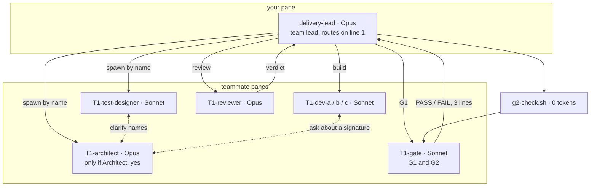
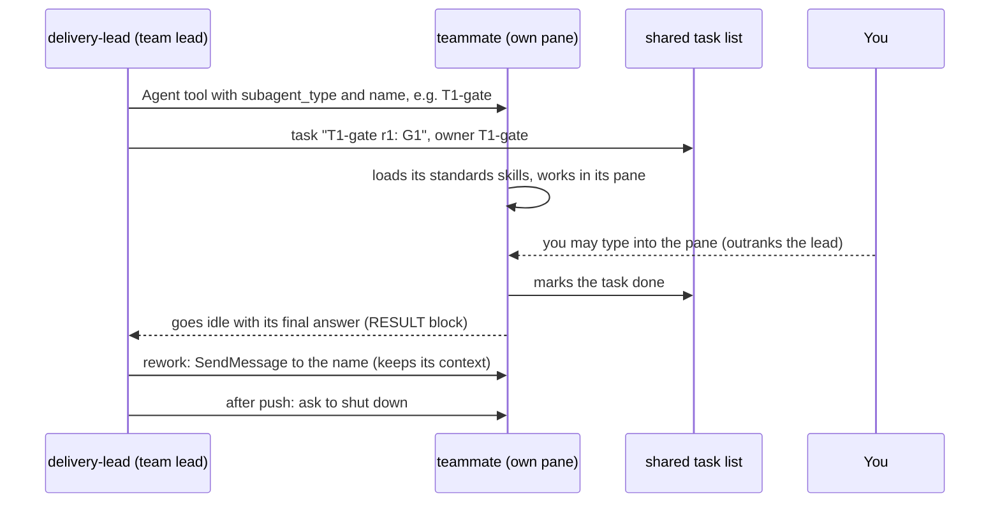

# claude-team: Claude Code port (agent teams, lean flow)

Same agents, skills, rules, hooks, scripts and checks as `../claude/` (the `kiro-mds-2` lean flow), but the leads run
the role agents as **agent-team teammates** instead of subagents. This is the closest match to the Kiro iTerm-pane
setup: every teammate is a full Claude Code session in its own pane, you can type into it, and teammates can message
each other.

Agent teams are **experimental** in Claude Code. If something misbehaves, `../claude/` (subagents) is the stable
fallback. Both use the same `~/.claude/` paths, so install one or the other, not both.

## Install

```bash
cd claude-team
mkdir -p ~/.claude
cp -R agents skills rules team hooks scripts checks ~/.claude/
# Merge, don't overwrite, if you already have these:
cat CLAUDE.md          # append to ~/.claude/CLAUDE.md
cat settings.json      # merge "env", "teammateMode" and "hooks" into ~/.claude/settings.json
chmod +x ~/.claude/hooks/*.py ~/.claude/scripts/*.sh ~/.claude/scripts/git-hooks/commit-msg
rm -rf ~/.claude/skills/engineering-standards   # replaced by the es-* skills
```

For split panes in iTerm2: install the `it2` CLI (https://github.com/mkusaka/it2) and turn on iTerm2 → Settings →
General → Magic → **Enable Python API**. Without them, `teammateMode: "auto"` falls back to in-process: teammates run
inside the lead's terminal (↑/↓ to pick one, Enter to open it, Ctrl+T for the task list).

Copy your `~/.kiro/scripts/webex-notify.py` to `~/.claude/scripts/`.

## Use

Same as before:
- `claude --agent planning-lead`, then give it the requirement.
- `claude --agent delivery-lead`, then `run <slug> T<n>` and, at the end, `push T<n>`.

Permission prompts from teammates show up in the **lead's** pane. Approve them there.

## How it runs

### Workflow 2: one task, one pane per teammate



Solid arrows go through the lead. Dotted arrows are direct teammate messages for clarification only. Any change to a
file, a decision or a rework item still goes through the lead or the gate.

### How the lead runs a teammate



## Differences from the subagent version

| Topic | `claude/` (subagents) | `claude-team/` (agent teams) |
|---|---|---|
| Where agents run | inside the lead session | own pane each (or the in-process agent panel) |
| You type into a worker | no (you can only read its transcript) | yes, click its pane |
| Agents talk to each other | no, everything goes through the lead | yes, by name, for clarifications. Decisions and rework still go through the lead or the gate |
| Planner critique | each planner critiques the plan alone | planners also exchange critiques with each other |
| Live progress | `status.md`, transcripts | shared task list (Ctrl+T) + `status.md` |
| Standards loading | preloaded via `skills:` | each teammate loads its `es-*` skills itself (the prompts say so) |
| Per-role limits | frontmatter hook + global hook | **global hook only** (keyed on `agent_type`). Not verified for teammates, so the prompts also say to follow the limits |
| After `/resume` | agents resumable by id | teammates are gone. The lead spawns fresh ones that read the files |
| Teams per session | n/a | one. `switch T<m>` adds T<m>'s teammates to the same team |
| Token use | lower | much higher: each teammate is a full session |
| Clean up | nothing to do | lead asks teammates to shut down after push |

## Things to check on the first run

1. Teammates open in panes. If not, check `which it2` and the iTerm2 Python API setting.
2. A teammate tries to write a file its role does not own, for example the gate writing `architecture.md`. If
   `agent-guard.py` does not block it, per-role limits don't fire for teammates: use `../claude/` for real work, or
   approve writes yourself (default permission mode).
3. Each teammate's first step is loading its standards skills.
