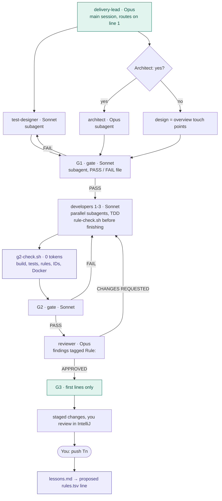
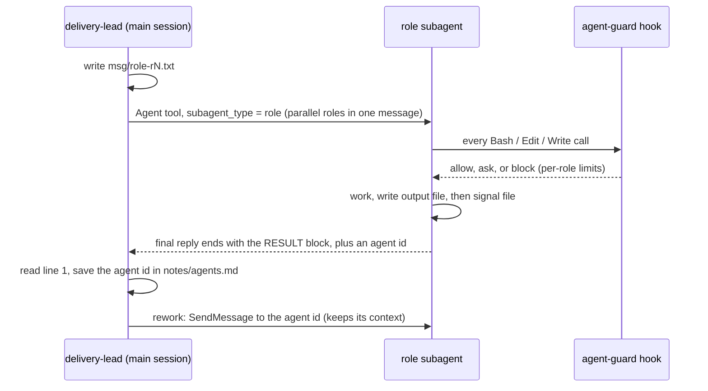
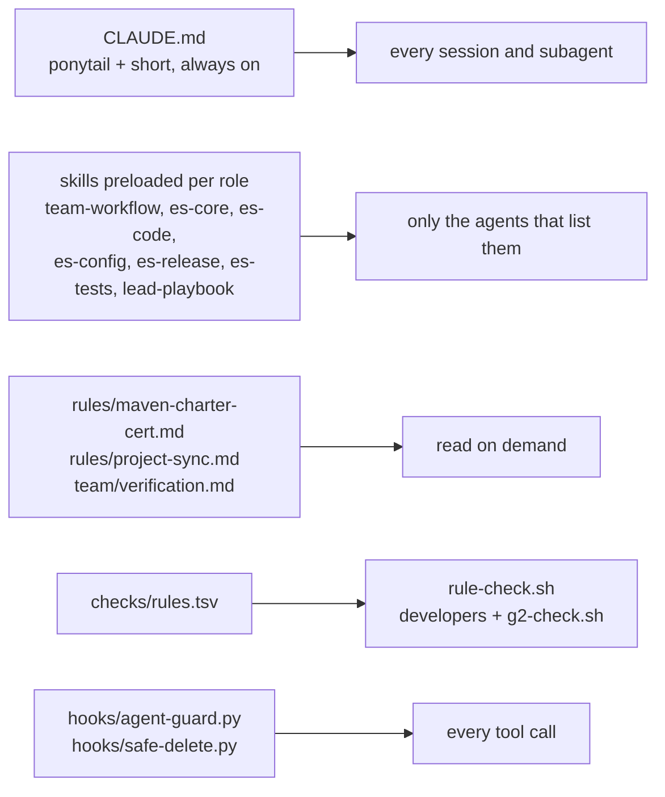

# claude: Claude Code port (subagents, lean flow)

The `kiro-mds-2` lean workflow for Claude Code. The leads run as the main session (`claude --agent <lead>`); role
agents run as **subagents** inside the lead's session. Everything goes into `~/.claude/`.

## Install

```bash
cd claude
mkdir -p ~/.claude
cp -R agents skills rules team hooks scripts checks ~/.claude/
# Merge, don't overwrite, if you already have these:
cat CLAUDE.md          # append to ~/.claude/CLAUDE.md
cat settings.json      # merge the "hooks" block into ~/.claude/settings.json
chmod +x ~/.claude/hooks/*.py ~/.claude/scripts/*.sh ~/.claude/scripts/git-hooks/commit-msg
# an older install of this folder had one big standards skill; remove it:
rm -rf ~/.claude/skills/engineering-standards
```

Copy your own `~/.kiro/scripts/webex-notify.py` to `~/.claude/scripts/` (the leads skip Webex posts if it is missing).

## Use

| Kiro | Claude Code |
|---|---|
| `kiro-cli chat --agent planning-lead` | `claude --agent planning-lead`, then the requirement or `resume <slug>` |
| `kiro-cli chat --agent delivery-lead` | `claude --agent delivery-lead`, then `run <slug> T<n>` / `resume <slug> T<n>` / `push T<n>` |
| `kiro-cli chat --agent developer` (direct) | `claude --agent developer` (direct mode: questions → plan → `go` → code) |

## How it runs

### Workflow 2: one task

Same flow as `kiro-mds-2`: the lead routes on first lines, the gate subagent and the scripts do the checking.



### How the lead runs a role agent (no panes)



### Where the rules live



## What maps to what (from `kiro-mds-2`)

| `kiro-mds-2` | `claude/` |
|---|---|
| `agents/<name>.json` + `<name>-prompt.md` (8 agents incl. `gate`) | `agents/<name>.md`: frontmatter (`model`, `skills`, `hooks`, `disallowedTools`) + the same prompt |
| `claude-opus-5.5` / `claude-sonnet-5.5` | `model: opus` / `sonnet` (test-designer, gate, developer on Sonnet) |
| `steering/team/workflow.md`, `team/lead-playbook.md` | skills `team-workflow`, `lead-playbook` |
| `steering/team/standards/es-*.md` per role in `resources` | skills `es-core`, `es-code`, `es-config`, `es-release`, `es-tests`, preloaded per role through `skills:` |
| always-on steering `ponytail`, `short` | `rules/*.md` imported by `CLAUDE.md` (subagents load it too) |
| `maven-charter-cert`, `project-sync` | `rules/*.md`, read on demand (listed in `CLAUDE.md`, not imported) |
| `permissions.rules` per agent | `hooks/agent-guard.py`: same rules per role, incl. `gate` (frontmatter hook + global hook keyed on `agent_type`) |
| `scripts/g2-check.sh`, `scripts/rule-check.sh`, `checks/rules.tsv` | same files under `~/.claude/` |
| `team/templates/*`, `team/verification.md`, `team/migration-rules.md` | same files under `~/.claude/team/` |
| iTerm panes + `agent-pane.sh` + `wait-agents.sh` | subagents: parallel Agent calls in one message, results come back directly, rework with `SendMessage` |
| `safe-delete.json` → `safe-delete.py` | `hooks/safe-delete.py` (backups to `/tmp/claude-trash`) |

## Changes you should know about

- **No panes.** You can't type into a subagent mid-run; open its transcript to watch. Permission prompts from
  subagents show up in the lead session.
- **agent-guard limit:** Bash commands are checked by prefix (same as Kiro), so a Bash redirect, `cp` or `sed -i` is not
  path-checked.
- **iterm-split-agents** reads the options on screen before answering a prompt, instead of always saying yes.

## Not tested

- No full task has been run end to end in Claude Code.
- `g2-check.sh` and `rule-check.sh` were tested on throwaway repos only (see `../kiro-mds-2/README.md`).

## Agent teams instead of subagents

See `../claude-team/`: the same files, with each role agent as a teammate in its own iTerm pane.
