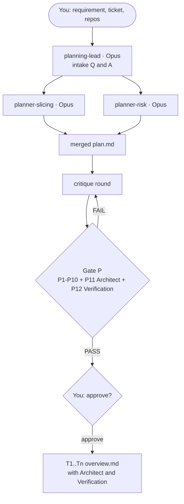
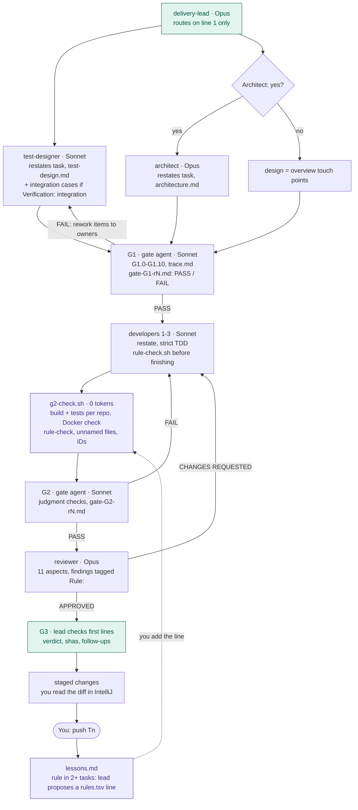
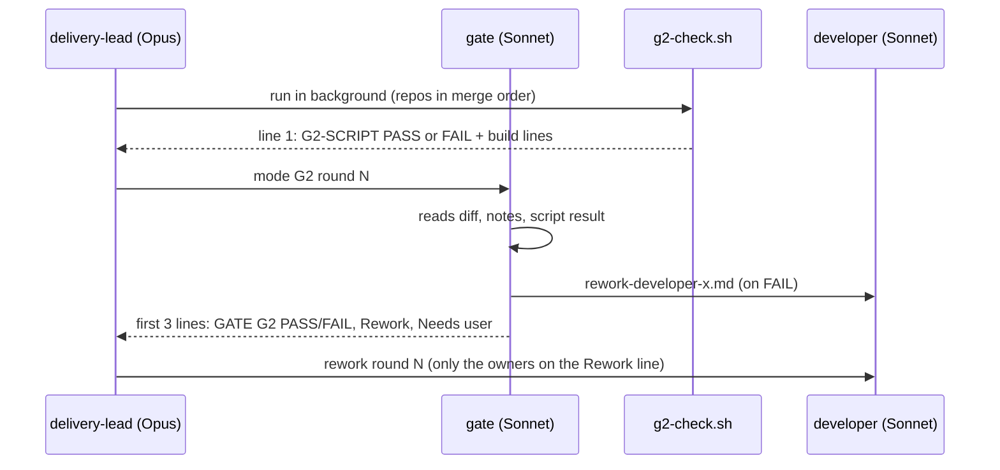

# kiro-mds-2: lean Kiro team setup

Same workflow and the same quality gates as `../kiro/`, with less expensive work. The Opus delivery lead stops checking
details itself: a Sonnet gate agent runs G1 and G2, and a script runs builds and mechanical checks.

The side-by-side comparison with `kiro/` is in the top-level README.

## How it runs

### Workflow 1: planning (`kiro-cli chat --agent planning-lead`)

Same council as `kiro/`, plus two checks per task at gate P: **P11** `Architect: yes/no` and **P12**
`Verification: standard/integration`.



### Workflow 2: one task (`kiro-cli chat --agent delivery-lead`, then `run <slug> T<n>`)



### What the lead actually reads



## Install

Copy over your `~/.kiro/` (back it up first):

```bash
cp -R ~/.kiro ~/.kiro.bak
cd kiro-mds-2
cp -R agents team hooks skills ~/.kiro/
mkdir -p ~/.kiro/steering/team/standards ~/.kiro/scripts
cp steering/*.md ~/.kiro/steering/
cp steering/team/workflow.md ~/.kiro/steering/team/
cp steering/team/standards/*.md ~/.kiro/steering/team/standards/
cp scripts/g2-check.sh scripts/rule-check.sh ~/.kiro/scripts/ && chmod +x ~/.kiro/scripts/g2-check.sh ~/.kiro/scripts/rule-check.sh
mkdir -p ~/.kiro/checks && cp checks/rules.tsv ~/.kiro/checks/
# the old single file and the symlinks must go, or agents load them again via the old globs:
rm ~/.kiro/steering/team/engineering-standards.md ~/.kiro/steering/team/maven-charter-cert.md ~/.kiro/steering/team/project-sync.md
```

Your existing scripts (`agent-pane.sh`, `wait-agents.sh`, `webex-notify.py`, `safe-delete.py`, `git-hooks/commit-msg`)
are still used and are not in this folder; keep them in `~/.kiro/scripts/`.

## Added from Lauren Tan's method

Her rule: when you correct an agent, don't add more prose; make it a deterministic check or design the mistake away.

| Idea | What it does here | Files |
|---|---|---|
| 7. Rules → checks | `rule-check.sh` checks only the lines a task **adds** against `checks/rules.tsv` (no `@Autowired`, no `System.out`, `Clock` for time, no empty catch, no star imports, no TODOs, no plain-text secrets; warnings for ticket refs, process notes, commented-out code). `error` fails G2, `warn` goes to the gate. Developers run it before they finish. The matching bullets are removed from `es-code.md` | `checks/rules.tsv`, `scripts/rule-check.sh`, `g2-check.sh`, `es-code.md` |
| 8. Correct once, then automate | Reviewer findings and gate rework items carry `Rule: <name>`. After each push the lead logs them to `~/Desktop/work/lessons.md`; a rule seen in 2+ tasks gets a proposed `rules.tsv` line (tested), or a reason why it can't be a pattern check | `reviewer-prompt.md`, `gate-prompt.md`, `lead-playbook.md` |
| 9. Prove it against the real thing | New overview field `Verification: standard / integration` (planning check **P12**). Integration = Testcontainers (Kafka, LocalStack, MongoDB) inside `mvn verify`, config repo files instead of the config server, snapshots via `settings.xml` or local `install`. Only for risky M/L message or data flows. `g2-check.sh` fails fast if Docker is down | `team/verification.md`, `es-tests.md`, templates, `planning-lead`, `test-designer`, `developer`, `gate` |
| 10. Restate first | Test-designer, architect and developer write `## Restated task` before working; a mismatch → `NEEDS_DECISION`. Gate check G1.0 compares it with the overview | role prompts, `gate-prompt.md` |

Not taken: multi-model reviews (too expensive) and UI tooling / feature maps (backend services).

**Adding a check** (when the lead proposes one, or you're tired of a review comment): add one TAB-separated line to
`~/.kiro/checks/rules.tsv`, then test it: `~/.kiro/scripts/rule-check.sh <worktree> <base>`. Patterns are POSIX ERE
(use `[[:space:]]`, not `\s`). Start new rules as `warn`; make them `error` once they have no false hits.

## What changed, file by file

| File | Change |
|---|---|
| `agents/gate.json`, `gate-prompt.md` | **New** Sonnet agent. G1 and the judgment part of G2. Writes the gate section of `review.md`, `notes/trace.md`, rework items, and `notes/gate-G<1|2>-r<n>.md` whose first 3 lines are `GATE … PASS|FAIL`, `Rework: …`, `Needs user: …` |
| `scripts/g2-check.sh` | **New.** G2.1 full build and tests per repo in merge order (with the Charter trust store), G2.4 files not named in the design, G2.8 internal IDs in added lines and commit messages. Writes `notes/g2-r<n>.md` (line 1 `G2-SCRIPT: PASS|FAIL`) |
| `agents/delivery-lead-prompt.md` | Rewritten gates: routes on first lines, no code reading, no own builds, G3 without a full-diff read |
| `agents/test-designer.json` | Model → `claude-sonnet-5.5` |
| `team/templates/overview.md` | New field `Architect: yes/no — reason` |
| `agents/planning-lead-prompt.md` | Gate check **P11**: sets `Architect`. `no` only if S, one repo, one developer, and no new class, public signature, config key, contract, DB query or external call. When unsure: `yes` |
| `agents/architect-prompt.md`, `developer-prompt.md`, `test-designer-prompt.md`, `reviewer-prompt.md` | Handle `Architect: no` (the overview's touch points and patterns are the design; the reviewer flags any new class or contract as MAJOR). The reviewer writes one `### Follow-ups` list for the lead |
| `steering/team/standards/es-*.md` | `engineering-standards.md` split into core, code, config, release, tests. The text is unchanged |
| `agents/*.json` resources | Explicit slices per role instead of `steering/team/**`. `maven-charter-cert.md` and `project-sync.md` are read on demand |
| `team/lead-playbook.md` | Gate pane (`T<n>-gate`, under the test-designer), "read line 1" rule, layout without an architect |
| `steering/team/workflow.md` | Roles table (gate, Sonnet test designer, optional architect), "Reading results" rule |

## Fixed prompt per agent (measured: resources + prompt, before any work)

| Agent | kiro/ | kiro-mds-2/ |
|---|---|---|
| `planning-lead` | 48 KB | 36 KB |
| `planner` | 34 KB | 20 KB |
| `delivery-lead` | 57 KB | 40 KB |
| `test-designer` | 34 KB | 25 KB (and Sonnet) |
| `architect` | 36 KB | 27 KB (skipped on small tasks) |
| `developer` | 35 KB | 34 KB |
| `reviewer` | 38 KB | 37 KB |
| `gate` | — | 37 KB (Sonnet) |

The bigger saving is not in this table. It is what the delivery lead no longer reads (code, diffs, build logs), because
that stays in the lead's context and is re-sent on every turn for the rest of the task. Measure one real task on each
version before you decide.

## Not tested

- `rule-check.sh` was tested on a seeded repo: every rule fired on new lines, old lines were ignored, and safe forms
  (`Instant.now(clock)`, `${VAULT_TOKEN}`, `// shortcut:`) passed. Known gap: a warn rule's `unless` applies to the
  whole line (`// EFFIE-123, UTF-8` is missed). Real-repo false-hit rates are unknown: watch the first few tasks.
- The Testcontainers flow (`verification.md`) is guidance; no DTC repo has been run with it.
- `g2-check.sh` was tested on throwaway git repos (config-repo path, unnamed-file list, ID detection, rule checks). The Maven path
  (JDK pick, trust store, `clean install`, the `Tests run:` line) has not been run against a real DTC repo. Run it once by
  hand on a finished task and compare with your own `mvn` output.
- The full lean flow has not been run end to end in Kiro.

## If quality drops

- Test cases miss edge cases often (G1 or the reviewer catch them): set `test-designer.json` back to `claude-opus-5.5`.
- Small tasks without an architect come back with design findings: make P11 stricter, or always `Architect: yes`.
- Gate PASSes that the reviewer then fails on the same point: put the gate on Opus for that check, or let the lead
  open the gate file on every PASS.
