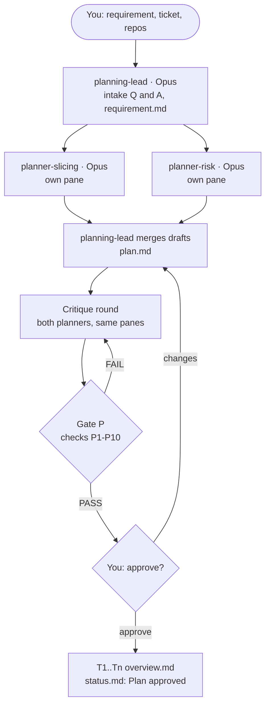
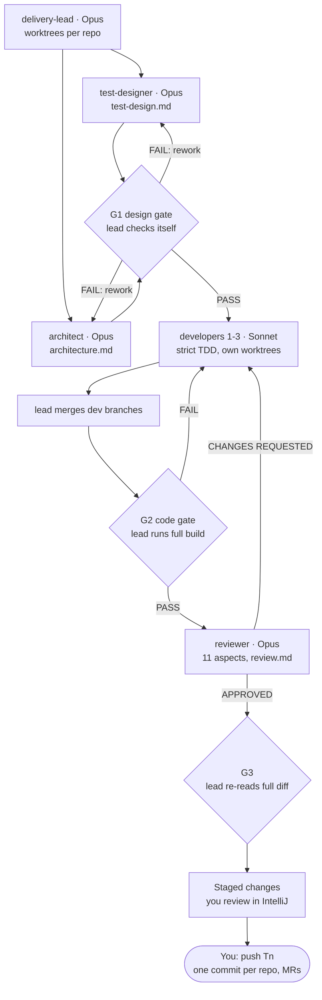
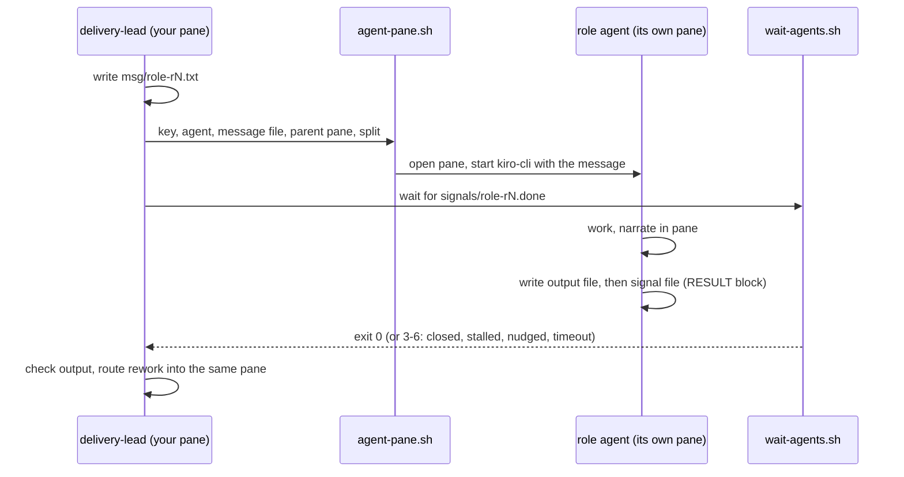

# kiro: original Kiro team setup

The original Kiro CLI config: 7 agents, steering, hooks, skills, the lead playbook and templates. The lean version
of the same workflow is in `../kiro-mds-2/`.

Install: copy the folders over `~/.kiro/` (`agents`, `steering`, `team`, `hooks`, `skills`). The pane scripts
(`agent-pane.sh`, `wait-agents.sh`), `webex-notify.py`, `safe-delete.py` and `git-hooks/commit-msg` are not in this
folder; they live in your `~/.kiro/scripts/`.

## How it runs

### Workflow 1: planning (`kiro-cli chat --agent planning-lead`)

### Workflow 2: one task (`kiro-cli chat --agent delivery-lead`, then `run <slug> T<n>`)

### How the lead runs an agent (iTerm panes)

Each agent's limits (which files it may write, which shell commands it may run) are in its `agents/<name>.json`
under `permissions.rules`. The `safe-delete` hook backs up deletes and blocks destructive git commands for every agent.
